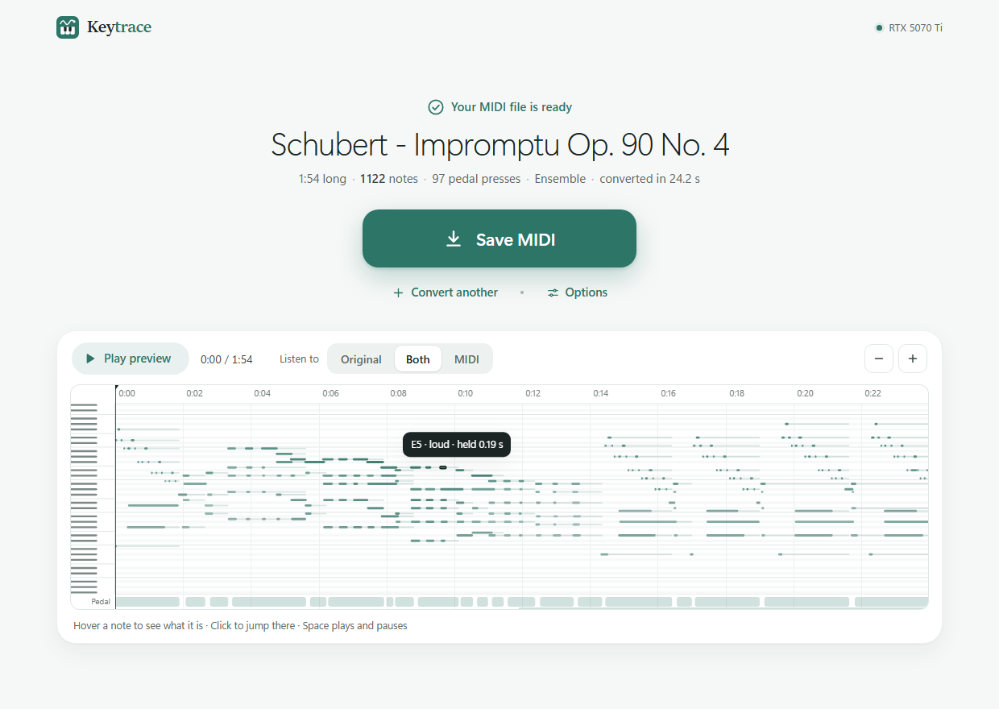
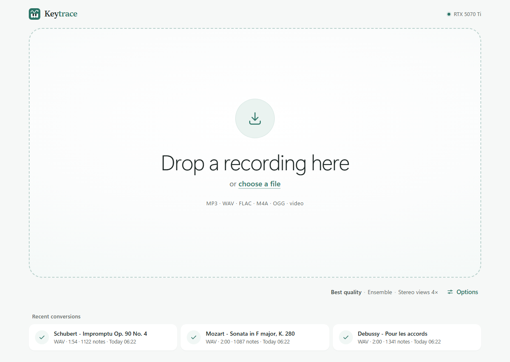
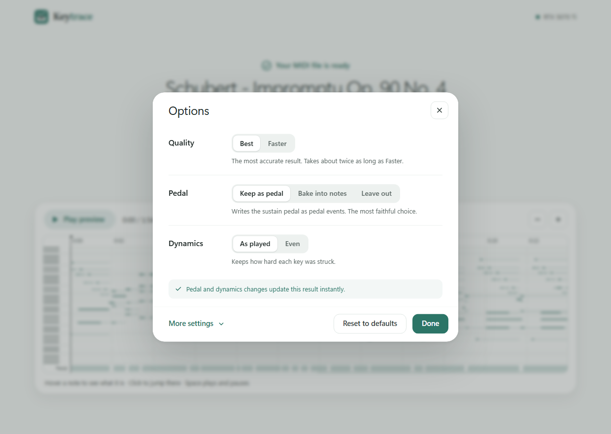
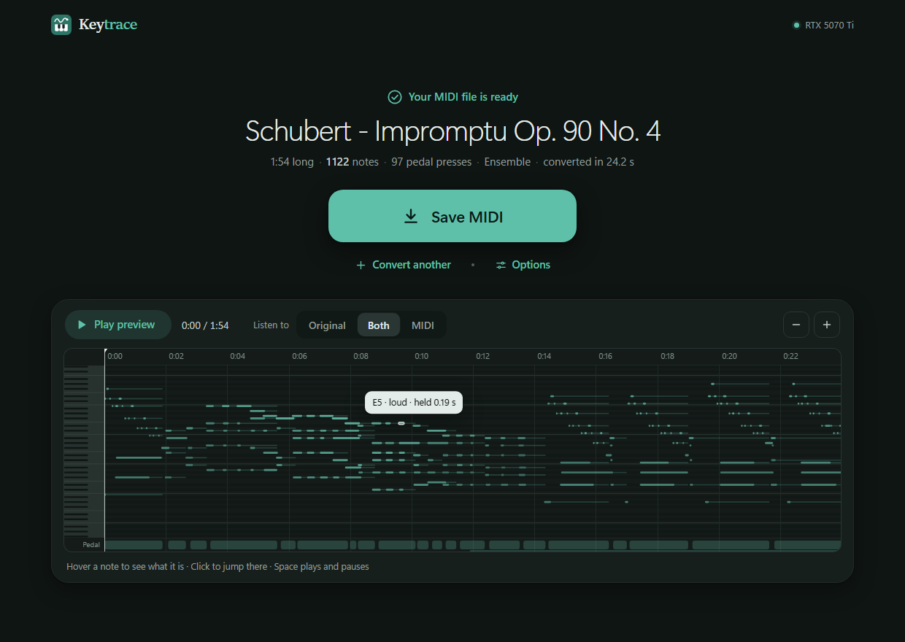

<p align="center">
  
</p>

<h1 align="center">Keytrace</h1>

<p align="center">
  <b>Turn piano recordings into MIDI.</b><br>
  State-of-the-art accuracy, running privately on your own PC.
</p>

<p align="center">
  <a href="https://github.com/Zoryc/Keytrace/releases/latest"><b>Download for Windows</b></a>
  &nbsp;·&nbsp; <a href="#accuracy">Accuracy</a>
  &nbsp;·&nbsp; <a href="#install">Install</a>
  &nbsp;·&nbsp; <a href="#questions">Questions</a>
</p>

<p align="center">
  
</p>

## Why Keytrace

- **Accurate.** On the standard MAESTRO piano benchmark, Keytrace finds **98.6 % of the notes**. It stays above 96 % on phone, MP3, noisy and reverberant recordings.
- **Complete.** Every note, how hard each key was struck (velocity), and the **sustain and soft pedals**.
- **Effortless.** Drop a recording and click **Save MIDI**. You can also right-click any audio or video file in Explorer and choose **Convert to MIDI with Keytrace**.
- **Check before you save.** A piano-roll preview plays on a sampled grand piano. Switch between **Original**, **Both** and **MIDI** to compare with the recording.
- **Private.** Transcription runs entirely on your PC and graphics card. Your recordings never leave your computer, and no internet is needed after setup.

Keytrace is made for **solo piano**.

<table>
  <tr>
    <td></td>
    <td></td>
    <td></td>
  </tr>
  <tr>
    <td align="center">Drop a recording</td>
    <td align="center">Three simple options</td>
    <td align="center">Light or dark</td>
  </tr>
</table>

## Install

1. Download **`Keytrace-Setup-0.2.0.exe`** (31 MB) from the [latest release](https://github.com/Zoryc/Keytrace/releases/latest).
2. Run it. It installs for your user only, so no administrator rights are needed.
   - Windows may say *"Windows protected your PC"* because the installer isn't code-signed. Click **More info**, then **Run anyway**.
3. Keep **Ensemble mode** ticked for the best accuracy. Choose a desktop shortcut and the right-click menu entry if you want them.
4. Setup then downloads what Keytrace needs, about **3 GB** (roughly 5 minutes on a fast connection):

| Component | Download | |
|---|---|---|
| Keytrace | about 2.8 GB | Python, PyTorch for your NVIDIA GPU, the Transkun V2 model |
| Ensemble mode (Aria-AMT) | about 450 MB | the most accurate setting, on by default |

**Requirements**
- Windows 10 or 11, 64-bit.
- An NVIDIA graphics card (RTX recommended). Without one, Keytrace runs on the processor, much more slowly.
- About 8 GB of free disk space.
- Internet during setup only.

If the download is interrupted, open Keytrace and it finishes the setup.

To uninstall, use Windows **Settings → Apps → Keytrace**. It asks whether to keep your conversion history.

## Using Keytrace

1. Open **Keytrace** from the Start menu.
2. Drop a recording on the window, or click **choose a file**. It reads MP3, WAV, FLAC, M4A/AAC, OGG/Opus, WMA and AIFF, and the audio of MP4, MKV, MOV and WebM videos.
3. Conversion starts right away. A 2-minute piece takes about 15 seconds on an RTX 5070 Ti (10 to 25, depending on how many notes it has).
4. Listen to the preview and press **Space** to play or pause. Hover a note to see what it is, its loudness and its length. Notes Keytrace is unsure about are drawn dashed.
5. Click **Save MIDI**.

Your recent conversions stay on the home screen; click one to open it again.

### Options

Three plain choices cover almost everything:

| Option | Choices |
|---|---|
| **Quality** | **Best**: Ensemble, the most accurate. **Faster**: about three times as quick and almost as accurate. |
| **Pedal** | **Keep as pedal**: sustain pedal events, the most faithful. **Bake into notes**: for apps that ignore the pedal. **Leave out**. |
| **Dynamics** | **As played**: every key's real loudness. **Even**: all notes the same. |

**More settings** adds:
- **Engine:** Ensemble, Transkun V2 or Aria-AMT, plus each one's own settings.
- **Second opinion:** how readily Aria-AMT may add notes.
- **Output:** soft pedal, minimum note length and MIDI tempo.
- **Appearance:** light, dark, or matching Windows.

Pedal, dynamics and the other file options update an open result instantly, without converting again.

## Accuracy

Measured on **12 two-minute excerpts from the MAESTRO v3 test set**, recordings none of the models were trained on. The benchmark uses the standard transcription metric: a note counts when its pitch is right and it starts within 50 ms. The same excerpts were also degraded to imitate real-world recordings.

| | Clean | MP3 128k | Phone | Concert-hall reverb | Noise | All combined |
|---|---|---|---|---|---|---|
| **Keytrace (Ensemble)** | **98.61** | **98.59** | **97.79** | **98.60** | **98.11** | **96.62** |
| Transkun V2 alone | 98.38 | 98.37 | 97.37 | 98.36 | 97.74 | 96.00 |
| Aria-AMT alone | 97.54 | 97.56 | 95.82 | 97.62 | 96.70 | 89.96 |
| MuScriptor medium (multi-instrument) | 86.46 | | | | | |

The Ensemble also improves where notes end, including how long the pedal holds them, and keeps loudness accuracy unchanged. Every rule was chosen by cross-validation, never tuned on the pieces it is measured on. The method and the full tables are in [`bench/`](bench).

### How it works

1. **[Transkun V2](https://github.com/Yujia-Yan/Transkun)** (ISMIR 2024) transcribes the recording.
   - A transformer scores every possible note, and an exact decoder picks the best set.
   - Keytrace analyses each passage from four stereo views and averages them, runs at full precision, and fixes an upstream bug that cut long pedal presses.
   - Each note also gets its exact confidence.
2. **[Aria-AMT](https://github.com/EleutherAI/aria-amt)** gives a second opinion. A note only Aria hears is added when Transkun was itself unsure about that spot, and it gets Transkun's own estimate of when the key was released.
3. The MIDI keeps real key releases, velocities, and sustain and soft pedal events.

## Limitations

- **Solo piano only.** With other instruments playing, their notes can be written as piano notes.
- **Pedals:** sustain and soft pedal are on/off; half-pedalling and the middle (sostenuto) pedal aren't detected.
- **Highest notes:** the very top of the keyboard (around C8) is sometimes missed.
- **Heavy reverb** can make notes look longer than they were played.

## Questions

**Windows says "Windows protected your PC".**
The installer isn't code-signed. Click **More info**, then **Run anyway**.

**The setup download failed.**
Check your connection and open Keytrace; it resumes the setup. The full log is in `setup.log` in the install folder (`%LOCALAPPDATA%\Programs\Keytrace` by default).

**I don't have an NVIDIA graphics card.**
Keytrace still works on the processor, but a 2-minute piece takes minutes instead of seconds.

**Where are my files?**
Your MIDI files go where you save them. Conversion history and settings are in `%LOCALAPPDATA%\Keytrace`. Versions before 0.2.0 were called *MIDI Converter*; their history is moved there automatically.

**Can I use the MIDI files commercially?**
The models were trained on the MAESTRO dataset (CC BY-NC-SA 4.0), and the Aria-AMT weights are non-commercial. Treat transcriptions as fine for personal use.

<details>
<summary><b>For developers</b></summary>

Requirements: Windows, Python 3.13, an NVIDIA GPU.

```bash
python -m venv .venv
```

```bash
.venv\Scripts\python -m pip install torch==2.11.0 torchaudio==2.11.0 --index-url https://download.pytorch.org/whl/cu128
```

```bash
.venv\Scripts\python -m pip install -r requirements.txt
```

```bash
.venv\Scripts\python -m pip install --no-deps transkun==2.0.1 moduleconf==0.1.4
```

```bash
.venv\Scripts\python scripts\fetch_piano_samples.py
```

Run the app:

```bash
.venv\Scripts\python -m midiconv
```

Convert from the command line:

```bash
.venv\Scripts\python -m midiconv convert "recording.mp3" -o "recording.mid"
```

The optional Aria-AMT engine is installed by `scripts/install_aria.py`, plus `scripts/get_aria_weights.py` for its weights.

Build the installer (see [installer/README.md](installer/README.md)):

```bash
powershell -NoProfile -ExecutionPolicy Bypass -File installer\build.ps1
```

The benchmark scripts are in `bench/`:
- `fetch_maestro.py` downloads the excerpts (about 230 MB).
- `degrade.py` makes the degraded copies.
- `evaluate.py` scores engines.
- `fusion.py` analyses the ensemble.

| Path | What |
|---|---|
| `midiconv/` | the app's Python package (it keeps its original name) |
| `midiconv/engines/` | Transkun, Aria-AMT and Ensemble engines |
| `midiconv/desktop.py` | the app window (WebView2), single instance, file hand-off |
| `midiconv/server.py`, `jobs.py`, `pipeline.py` | local backend: job queue and conversion pipeline |
| `web/` | the interface (HTML, CSS, JS; no build step) |
| `installer/` | Inno Setup script, launcher and setup window, build script |
| `bench/` | accuracy benchmark |
| `design/` | the 12 design studies the interface was chosen from |

</details>

## Credits

- [Transkun](https://github.com/Yujia-Yan/Transkun) by Yujia Yan (MIT; weights trained on MAESTRO).
- [Aria-AMT](https://github.com/EleutherAI/aria-amt) by EleutherAI (Apache-2.0; weights CC BY-NC-SA 4.0).
- [MAESTRO](https://magenta.tensorflow.org/datasets/maestro) by Hawthorne et al., 2019 (CC BY-NC-SA 4.0).
- Splendid Grand Piano samples by Akai (public domain), played by [smplr](https://github.com/danigb/smplr).
- [pywebview](https://pywebview.flowrl.com/), [PyAV](https://github.com/PyAV-Org/PyAV)/FFmpeg, soxr, pretty_midi, mir_eval, FastAPI, [uv](https://github.com/astral-sh/uv) and [Inno Setup](https://jrsoftware.org/isinfo.php).
